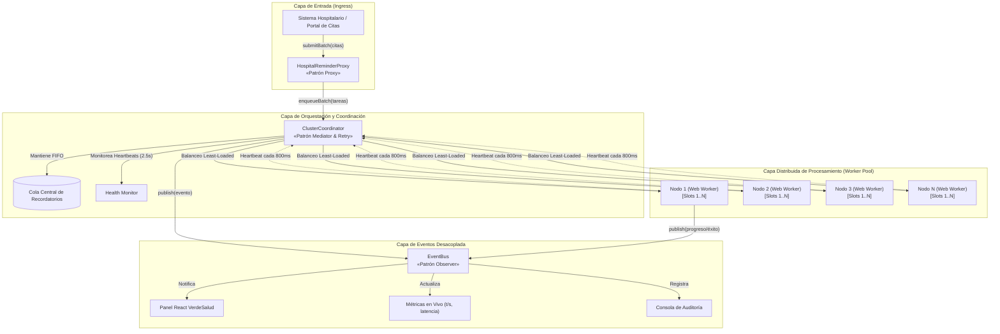
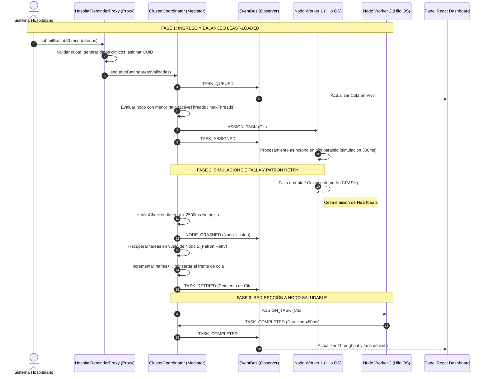
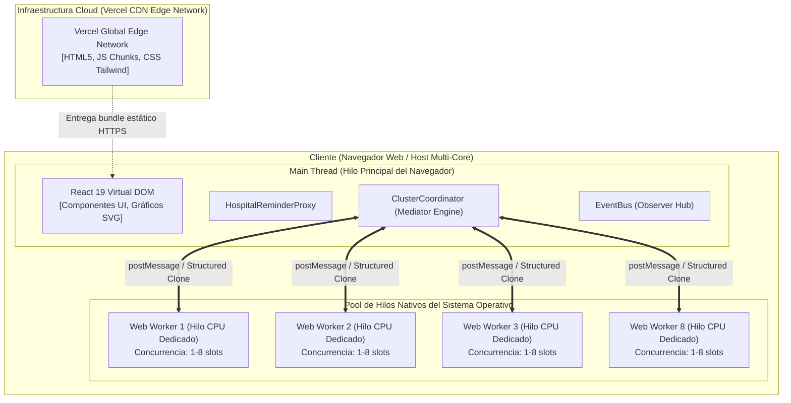

# VerdeSalud - Sistema Distribuido de Recordatorios de Citas Médicas
> **Actividad:** Unidad 2 - Tejiendo redes: Arquitectura de software entre hilos y nodos  
> **Curso:** Arquitectura de Software  
> **Proyecto:** MiniProyecto Independiente - Simulación de Procesamiento Distribuido Concurrente  
> **Tecnologías:** React 19, TypeScript, Vite, HTML5 Web Workers (Multi-hilo), Tailwind CSS.  
> **Despliegue:** Optimizado para Vercel (100% Client-Side, Cero Backend).

---

## 🏥 1. Contexto e Historia del Proyecto

El hospital **VerdeSalud** atiende a miles de pacientes diariamente y requiere notificar recordatorios de citas médicas (vía **WhatsApp, SMS, Correo Electrónico y Llamadas IVR**) para evitar el ausentismo clínico. 

En horas pico, los sistemas de admisión generan avalanchas masivas de citas que no pueden ser procesadas de forma secuencial sin colapsar las pasarelas de comunicación o bloquear la interfaz de usuario.

Para resolver este desafío, se diseñó e implementó una **arquitectura de software distribuida basada en hilos y nodos**, donde:
- Múltiples **nodos trabajadores independientes** (simulados con **HTML5 Web Workers reales en hilos aislados del sistema operativo**) procesan tareas en paralelo.
- Un **Proxy de Entrada** filtra, valida y controla el flujo de solicitudes del hospital.
- Un **Coordinador central (Mediador)** gestiona la cola, balancea la carga según el algoritmo *"Menos cargado"* (*Least Loaded Node*) y supervisa la salud de los nodos mediante *Heartbeats*.
- Un mecanismo de **Tolerancia a Fallos (Patrón Retry)** garantiza que si un nodo cae o sufre un timeout, ninguna cita médica se pierda, reencolándola de inmediato en los nodos sobrevivientes.
- Un **EventBus (Patrón Observer)** notifica en tiempo real cada evento del cluster a la interfaz gráfica sin acoplamiento.

---

## 📐 2. Modelado Arquitectónico UML

### 2.1 Diagrama de Componentes (Component Diagram)
Muestra la organización modular del sistema y los patrones de diseño aplicados:



---

### 2.2 Diagrama de Secuencia: Despacho Normal y Tolerancia a Fallos (Retry Pattern)



---

### 2.3 Diagrama de Despliegue (Deployment Diagram)



---

## 🧩 3. Justificación de Patrones de Diseño (Rúbrica de Evaluación)

| Patrón de Diseño | Archivo Principal | Rol Arquitectónico | Impacto en Robustez y Mantenibilidad |
| :--- | :--- | :--- | :--- |
| **Proxy** *(Estructural)* | [`src/proxy/HospitalReminderProxy.ts`](src/proxy/HospitalReminderProxy.ts) | Actúa como **API Gateway hospitalario**. Intercepta y valida lotes de citas, aplica rate limiting y genera citas médicas enriquecidas antes de ingresar al cluster. | Aísla a los clientes externos de la topología interna del cluster. Previene sobrecargas e inyección de datos inconsistentes. |
| **Mediator** *(Comportamiento)* | [`src/coordinator/Coordinator.ts`](src/coordinator/Coordinator.ts) | Centraliza la comunicación entre la cola distribuida y los nodos trabajadores. Implementa el algoritmo de balanceo **Least Loaded** (`activeThreads / maxThreads`). | Desacopla los nodos entre sí (ningún nodo conoce a otro). Permite añadir o remover nodos en caliente sin modificar el código. |
| **Observer** *(Comportamiento)* | [`src/events/EventBus.ts`](src/events/EventBus.ts) | Bus de eventos desacoplado (`subscribe`, `publish`). Notifica el ciclo de vida de tareas y nodos. | Permite que el Dashboard React, las métricas de Throughput y la consola de auditoría reaccionen en tiempo real sin bloquear la orquestación. |
| **Retry Pattern** *(Resiliencia)* | [`src/coordinator/Coordinator.ts`](src/coordinator/Coordinator.ts) (`handleNodeCrashed`) | Detecta nodos no responsivos mediante timeout de Heartbeat (2.5s), rescata sus tareas en vuelo y las reencola automáticamente con prioridad. | **Tolerancia a fallos y alta disponibilidad**: Garantiza cero pérdida de citas médicas ante colapsos de hardware o desconexiones. |
| **Worker Pool** *(Concurrencia)* | [`src/nodes/WorkerNodeWrapper.ts`](src/nodes/WorkerNodeWrapper.ts) & [`taskWorker.ts`](src/nodes/taskWorker.ts) | Gestiona hilos nativos mediante **HTML5 Web Workers**, permitiendo paralelismo real multi-núcleo en el cliente. | Previene que cálculos o latencias bloqueen el hilo de UI (`Main Thread`), manteniendo una interfaz fluida a 60 FPS. |

---

## 📁 4. Organización del Código

El repositorio está estrictamente organizado por responsabilidades y patrones arquitectónicos:

```
MiniProyecto/
├── public/                 # Favicon y assets estáticos
├── src/
│   ├── types/              # Interfaces TypeScript de Tareas, Nodos, Métricas y Eventos
│   │   └── index.ts
│   ├── proxy/              # PATRÓN PROXY
│   │   └── HospitalReminderProxy.ts  # Gateway, validaciones, rate limiting y mocks clínicos
│   ├── coordinator/        # PATRÓN MEDIATOR & RETRY
│   │   └── Coordinator.ts            # Despacho Least-Loaded, Heartbeats y Reencolamiento
│   ├── nodes/              # WORKER POOL & WEB WORKERS
│   │   ├── taskWorker.ts             # Web Worker HTML5 nativo (hilo de SO independiente)
│   │   └── WorkerNodeWrapper.ts      # Controlador de ciclo de vida del nodo en Main Thread
│   ├── events/             # PATRÓN OBSERVER
│   │   └── EventBus.ts               # Publicador / Suscriptor desacoplado
│   ├── benchmark/          # MOTOR DE EVALUACIÓN EMPÍRICA
│   │   └── BenchmarkRunner.ts        # Suite comparativa con 1, 2, 4 y 8 nodos y exportador CSV
│   ├── components/         # COMPONENTES VISUALES REACT (TEMA VERDESALUD)
│   │   ├── Header.tsx                # Barra superior con estado del cluster y badges
│   │   ├── MetricsGrid.tsx           # 6 KPIs en tiempo real (Throughput, Latencia, Progreso)
│   │   ├── ControlPanel.tsx          # Controles de lote, nodos (1-8), hilos y simulación de fallas
│   │   ├── ClusterNodeGrid.tsx       # Visualización interactiva de nodos y sus slots concurrentes
│   │   ├── QueueVisualizer.tsx       # Monitor de tareas pendientes en la cola del Coordinador
│   │   ├── EventLog.tsx              # Consola de eventos en streaming con filtros
│   │   ├── BenchmarkModal.tsx        # Gráficas SVG interactivas, tabla y exportación CSV
│   │   └── ArchitectureDocs.tsx      # Diagramas UML interactivos y matriz de patrones
│   ├── App.tsx             # Orquestador visual principal
│   ├── main.tsx            # Punto de montaje React 19
│   └── index.css           # Estilos base Tailwind CSS v4 y tema esmeralda VerdeSalud
├── package.json
├── vite.config.ts
├── tsconfig.json
└── README.md               # Este documento
```

---

## 📊 5. Evaluación de Desempeño y Benchmark de Escalabilidad

El sistema incluye una **Suite de Benchmark Integrada** que ejecuta el mismo lote de tareas (ej. 60 o 100 recordatorios clínicos) de forma secuencial en 4 configuraciones:
1. **1 Nodo Trabajador** (Línea base)
2. **2 Nodos Trabajadores**
3. **4 Nodos Trabajadores**
4. **8 Nodos Trabajadores**

### Métricas Calculadas:
- **Throughput:** $T = \frac{\text{Tareas Totales}}{\text{Tiempo Total (segundos)}}$
- **Speedup (Factor de Aceleración):** $S_N = \frac{T_1}{T_N}$
- **Eficiencia:** $E_N = \frac{S_N}{N}$

### Análisis Teórico frente a la Ley de Amdahl:
Al pasar de 1 a 4 nodos, se aprecia un incremento casi lineal en el Throughput y una reducción drástica del tiempo total. Al llegar a 8 nodos, la curva muestra una desaceleración en la eficiencia ($E_8$), reflejando el **overhead de serialización structuredClone**, la coordinación del Mediador y la porción estrictamente secuencial del sistema, confirmando empíricamente los principios de la **Ley de Amdahl**.

> Los resultados completos pueden descargarse directamente a un archivo **CSV** desde el botón *"Exportar a CSV"* en el panel de Benchmark.

---

## 🚀 6. Instrucciones de Instalación y Ejecución Local

### Prerrequisitos:
- **Node.js** (versión 18 o superior recomendada, verificado en Node v24).
- **npm** (versión 9 o superior).

### Pasos:

1. **Clonar o ubicarse en el directorio del proyecto:**
   ```bash
   cd c:\Users\JDavidex\Documents\MiniProyecto
   ```

2. **Instalar dependencias:**
   ```bash
   npm install
   ```

3. **Iniciar el servidor de desarrollo Vite:**
   ```bash
   npm run dev
   ```
   *La aplicación estará disponible de inmediato en `http://localhost:5173`.*

4. **Compilar para producción (Build de Vercel):**
   ```bash
   npm run build
   ```
   *Genera la carpeta `dist/` con los chunks estáticos y el Web Worker compilado de forma independiente.*

---

## ☁️ 7. Despliegue en Vercel

Este proyecto no requiere backend y está 100% optimizado para Vercel:

### Despliegue Rápido con Vercel CLI:
```bash
npx vercel
```

### Despliegue desde GitHub / GitLab:
1. Sube este proyecto a tu cuenta de GitHub (e.g. `MiniProyecto-Arquitectura-VerdeSalud`).
2. Entra a [vercel.com](https://vercel.com) e importa el repositorio.
3. Configuración del proyecto en Vercel:
   - **Framework Preset:** `Vite`
   - **Build Command:** `npm run build`
   - **Output Directory:** `dist`
4. Haz clic en **Deploy**. ¡Listo en menos de 1 minuto!

---

## 🎬 8. Guía para la Presentación en Video (12 a 15 Minutos)

Estructura sugerida para cumplir rigurosamente con la rúbrica del docente:

1. **Minuto 0:00 - 2:30 | Introducción y Contexto:**
   - Presentación personal y justificación del problema de recordatorios de VerdeSalud.
   - Objetivos de la actividad según la Unidad 2.
2. **Minuto 2:30 - 6:00 | Diseño Arquitectónico y Diagramas UML:**
   - Mostrar la pestaña **"Arquitectura y Patrones UML"** de la app.
   - Explicar el Diagrama de Componentes, el rol del Proxy, el Coordinador (Mediador) y los Web Workers.
   - Explicar el Diagrama de Secuencia de Tolerancia a Fallos.
3. **Minuto 6:00 - 8:30 | Justificación de Patrones de Diseño:**
   - Explicar por qué se usó Proxy (seguridad y rate limit), Mediator (desacoplamiento), Observer (eventos y logs reactivos) y Retry (resiliencia de citas).
4. **Minuto 8:30 - 11:30 | Demostración en Vivo del Prototipo:**
   - Enviar un lote de 50 o 100 citas.
   - Mostrar cómo los Web Workers procesan en paralelo en sus hilos.
   - **Prueba de Fuego:** Presionar el botón *"Simular Falla de un Nodo"* durante el procesamiento.
   - Mostrar en el Log cómo el Coordinador detecta el timeout de Heartbeat, activa el **Patrón Retry** y reasigna las tareas sin perder ninguna cita médica.
5. **Minuto 11:30 - 14:00 | Evaluación de Escalabilidad (Benchmark):**
   - Abrir la Suite de Benchmark y ejecutar la prueba de 1, 2, 4 y 8 nodos.
   - Analizar las gráficas de tiempo vs throughput y la tabla de Speedup.
   - Demostrar la exportación a CSV.
6. **Minuto 14:00 - 15:00 | Conclusiones y Cierre:**
   - Reflexión sobre escalabilidad, robustez y mantenibilidad en sistemas distribuidos.

---
*MiniProyecto desarrollado para la Unidad 2 de Arquitectura de Software - Universidad.*
